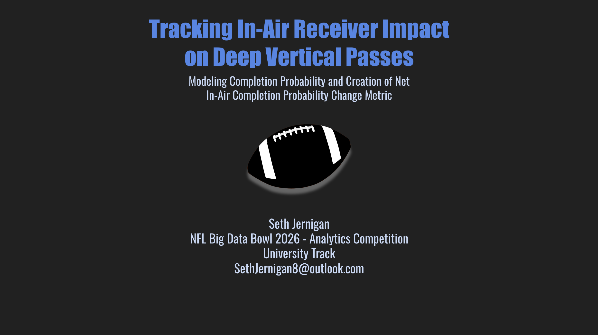
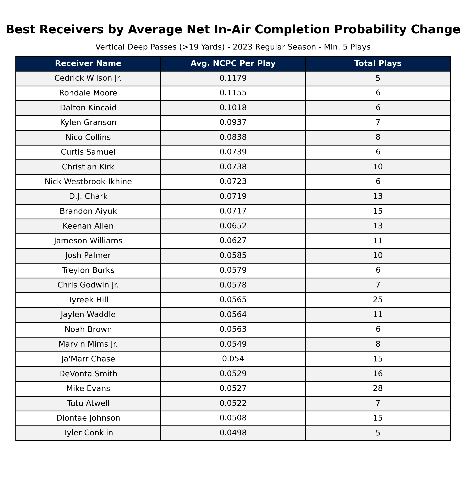
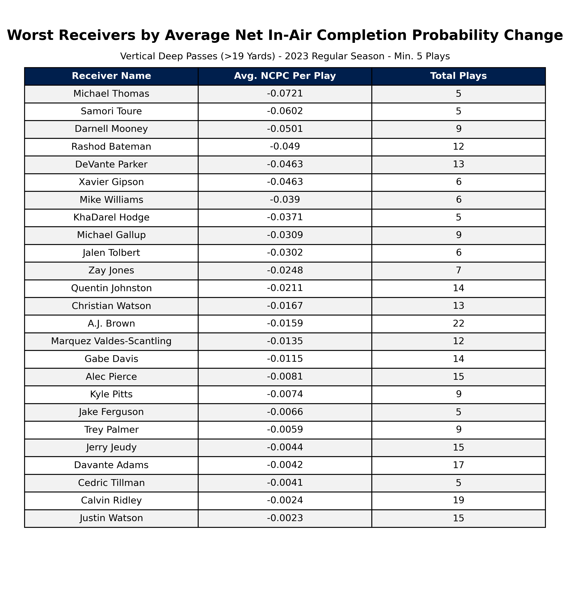
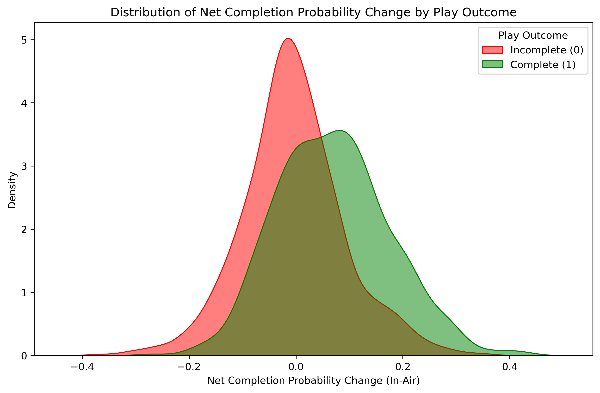

# NFL Big Data Bowl 2026: Net In-Air Completion Probability Change (NCPC)

Solo NFL Big Data Bowl 2026 project that models how much receiver impact on a deep pass's chance of being caught in flight, using frame-level tracking data, XGBoost, and a custom metric (NCPC).



> The full competition writeup is in [WRITEUP.md](WRITEUP.md).

## Overview

Deep passes are some of the most valuable offensive plays in football, yet teams still lack an effective way to quantify receivers' ability to adjust, track, and create catchable space once the ball is in the air. This project quantifies receivers' influence on completion probability while the ball is in flight.

**Net In-Air Completion Probability Change (NCPC)** is a play-level metric of how much a receiver raises or lowers a deep pass's completion probability in flight relative to release. It gives play callers (route design, matchups) and front offices (ball tracking, in-air playmaking) a new lens for evaluating receivers, and is aggregated here into 2023 NFL receiver rankings.

## Approach

1. **Post-release data reconstruction.** Post-release frames lacked speed, direction, and orientation. I rebuilt speed, acceleration, and direction from frame-to-frame player displacement, smoothed over a three-frame rolling window to stay continuous through release.
2. **Feature engineering.** I reshaped the data to a wide per-frame format (targeted receiver plus the four nearest defenders) and engineered receiver-motion, defender-pursuit, and receiver-defender interaction features (velocity toward the ball, separation, time-to-ball differentials), plus a flight-normalized time feature. The strongest separating features were receiver-defender distance, crowdedness, defender closing speed, ball distance advantage, and time-to-ball advantage.
3. **Completion probability model.** Each post-release frame is a training instance labeled with the play's outcome. I trained an XGBoost classifier with flight-normalized time as a feature, limiting tree depth, number of estimators, and learning rate so that estimates track spatial changes instead of memorizing play outcomes. The result is smooth, evolving completion probability curves.
4. **NCPC.** The probability curve from release to arrival is treated as continuous over flight-normalized time, and NCPC is the area above or below the release-time probability.
5. **Animation tool.** A Matplotlib notebook tool animates any play by ID alongside its evolving completion probability curve, making the model and metric interpretable.

## Results

NCPC rankings matched football intuition while surfacing less obvious deep threats. Among the top vertical-route receivers are Nico Collins, Tyreek Hill, and Ja'Marr Chase, along with several "gadget" receivers like Cedrick Wilson, Rondale Moore, and Christian Kirk.

| Receiver | Play | Completion probability | NCPC |
|---|---|---|---|
| Rondale Moore | 48-yard touchdown | ~25% at release → ~80% before arrival | **+0.277** |
| Michael Thomas | Deflected go route | ~35% at release → ~20% | **-0.093** |

Rankings and distributions:

| Best (vertical) | Worst (vertical) | NCPC distribution |
|---|---|---|
|  |  |  |

Animated examples: [rondale_moore.mp4](rondale_moore.mp4) and [michael_thomas.mp4](michael_thomas.mp4).

See [WRITEUP.md](WRITEUP.md) for the full results, limitations, and discussion.

## Repository Structure

| Path | Description |
|---|---|
| [Final Project Notebook.ipynb](Final%20Project%20Notebook.ipynb) | Full pipeline: data import, post-release reconstruction, feature engineering, model training, NCPC rankings, and play animations |
| [CompletionProbabilityAnimation.ipynb](CompletionProbabilityAnimation.ipynb) | Standalone play animation tool |
| [Exploratory Data Analysis.ipynb](Exploratory%20Data%20Analysis.ipynb), [Completion Probability Model.ipynb](Completion%20Probability%20Model.ipynb), [Model Analysis.ipynb](Model%20Analysis.ipynb), [ScratchWork.ipynb](ScratchWork.ipynb) | Earlier development notebooks that were consolidated into the final notebook |
| [WRITEUP.md](WRITEUP.md) | Competition writeup |
| [completion_prob_model_xgb.pkl](completion_prob_model_xgb.pkl) | Trained XGBoost model |
| `analytics_data/` | Competition tracking data (2023 season) |
| `*.png`, `*.mp4` | Rankings, distribution plots, and example animations |
| `Big Data Bowl Notes/` | Working notes (Obsidian) |

## Running the Animation

The animation is run in a notebook by entering a play's game and play ID:

```python
anim = animate_play(combined_deep, prob_data, game_id=2023111904, play_id=136)
HTML(anim.to_jshtml())
```

It shows player movement on the field with the completion probability curve beneath it. A dashed line marks the release-time probability, and a side panel shows game context and the play's NCPC.

To run it, execute the earlier cells of [Final Project Notebook.ipynb](Final%20Project%20Notebook.ipynb) first. They generate the intermediate files the animation reads (`data_with_probs.csv`, `combined_deep.csv`, and others). Those files are large and are not tracked in git.

## Tech

Python, Pandas, NumPy, Scikit-Learn, XGBoost, Matplotlib, Seaborn, Jupyter

## Limitations

- No catch radius or contact data
- Doesn't isolate the receiver from quarterback accuracy and defender quality
- Sensitive to off-schedule plays

## Data

2023 NFL tracking data provided by the NFL Big Data Bowl 2026 competition on Kaggle, stored in `analytics_data/`.
